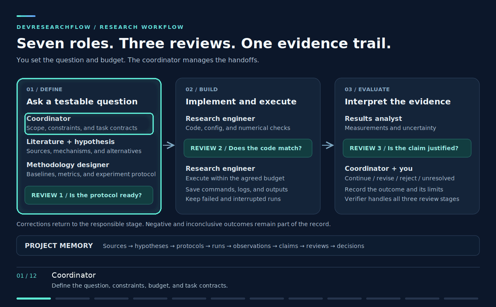

# DevResearchFlow

**Turn AI-assisted research into reviewed experiments and traceable evidence.**

[](https://github.com/Shakthi-Bala/DevResearchFlow/actions/workflows/test.yml?query=branch%3Adev)
[](https://github.com/Shakthi-Bala/DevResearchFlow/tags)
[](pyproject.toml)
[](LICENSE)



*Illustration of the workflow. The runnable demo executes real commands with synthetic data and clearly labeled review fixtures.*

[Quick start](#quick-start) · [What it does](#what-it-does) · [Try the demo](#try-the-demo) · [Guides](#learn-and-configure) · [Contributing](CONTRIBUTING.md)

Seven role contracts coordinate research through protocol, implementation and
evidence reviews. Python tools check structure, provenance and review gates;
independent reviewers assess scientific substance. Use it for thesis and research
projects where you need to inspect how a result was obtained, including failed
attempts and evidence that contradicts your hypothesis.

## What it does

| Capability | What you get |
| --- | --- |
| Plan before execution | Versioned protocols, baselines, metrics, budgets, and preregistration checks for confirmatory runs. |
| Review at three gates | Protocol, implementation, and evidence reviews with target hashes and reviewer-session checks. |
| Capture actual runs | Reviewed-code checks, logs, timestamps, exit codes, environment capture, and checksummed receipts. |
| Preserve inconvenient evidence | Failed and cancelled attempts, superseded reviews, and contradicting observations remain in the record. |
| Reduce record keeping | One `drf` CLI for draft records, review hashes, pinning, checked gate transitions, and next actions. |
| Check before committing | Schema, reference, artifact, and history validation through local commands, staged hooks, and project CI. |

## Quick start

Requires Python 3.10+, Git and an AI agent of your choice. The execution runner
and setup scripts target Unix-like systems; use WSL on Windows.

Install the development branch below. The latest tagged version is
[`v0.3.0`](https://github.com/Shakthi-Bala/DevResearchFlow/tree/v0.3.0);
changes since that tag are listed under [Unreleased](CHANGELOG.md#unreleased).

```bash
git clone --branch dev https://github.com/Shakthi-Bala/DevResearchFlow.git
cd DevResearchFlow
uv tool install .
```

Alternatively use `pipx install .` or `python3 -m pip install .`. No package has
been published to PyPI. Graphify is optional and is not required by these commands.

```bash
mkdir ~/my-research
cd ~/my-research
git init
drf init . --ci
drf status
```

Initialization preserves existing files and installs a staged-record pre-commit
hook by default in Git projects. Use `--no-hooks` to opt out. Existing hooks and
CI files are preserved. New projects require execution receipts and reviewer
identities; existing projects keep their legacy policy during updates.

Load `.research-toolkit/agents/coordinator.md` in your agent and give it:

> Read research/WORKFLOW.md and research/brief.md. Help me bound the question,
> plan and budget. Assign specialist work and independent reviews. Use fresh
> reviewer sessions, preferably a different model. Preserve failures and uncertainty.

Follow [Your first experiment](docs/first-experiment.md) for the full path from
question to a reviewed result, including exact prompts and commands.

## Try the demo

From an installed source checkout, build a complete example into a **new directory
outside the checkout**:

```bash
python3 -m venv .venv-research
.venv-research/bin/python -m pip install -e '.[dev]'
.venv-research/bin/python examples/toy-ablation/build.py /tmp/drf-ablation-demo
```

Choose a different destination if that directory already exists. No model API key
or downloaded dataset is needed. The demo executes two tiny CPU runs, including an
injected failure, and validates every recorded Git transition.

| Result | Evidence in the generated project |
| --- | --- |
| Failed attempt retained | `runs/RUN-001/`: partial logs, nonzero exit, manifest, and execution receipt. |
| Successful ablation | `runs/RUN-002/metrics.json`: baseline MSE **0**, ablated MSE **7.5**, difference **7.5** on four synthetic points. |
| Stale review detected | `research/sessions/stale-review.txt` and the superseded review. |
| Conclusion recorded | Linked observation, contradicted hypothesis, scoped claim, and `DEC-001`. |

Reviews in this demo are synthetic teaching fixtures. They demonstrate record
structure and checks; real research still requires independent review. See the
[example walkthrough](examples/toy-ablation/README.md) to inspect its history.

## Everyday commands

```bash
drf new hypothesis HYP-001 --model YOUR_MODEL --session YOUR_SESSION
drf review REV-001 --type protocol --model REVIEW_MODEL --session FRESH_SESSION \
  research/experiments/EXP-001.yaml
drf pin research/experiments/EXP-001.yaml --write
drf advance EXP-001 protocol_reviewed --review REV-001
drf run RUN-001 --timeout 3600
drf check
drf check --staged
drf status
```

Create and review an experiment before preparing a run; `drf run` executes a
previously planned run. Pinning applies to draft experiments; `advance` checks a
single next gate against actual reviews. Commit each gate before advancing again.
These commands illustrate separate workflow steps, not a script to run in sequence.
The runner refuses changed reviewed code, verifies per-file dataset
manifests, and captures logs, timestamps, exit codes, checksums and receipts.
A failed attempt remains evidence and needs a fresh run ID for another attempt.

Receipts detect ordinary edits and missing evidence. They are **not cryptographic
attestation** against someone controlling the repository, checker and execution host.
A passing validator does not establish scientific correctness.

## Learn and configure

| Guide | Purpose |
| --- | --- |
| [Runnable example](examples/toy-ablation/README.md) | Real execution, failed run, stale review, contradicted hypothesis; reviews are labeled teaching fixtures. |
| [First experiment](docs/first-experiment.md) | Ten steps with coordinator and verifier prompts. |
| [Daily commands](workflows/research/DAILY_USE.md) | Records, datasets, execution, status, hooks and CI. |
| [Record transitions](docs/record-states.md) | State diagram for every record type. |
| [Role permissions](docs/permissions.md) | Opt-in Codex and Claude runtime profiles and their limits. |
| [Migration and trust](docs/provenance.md) | Policy versions, identities, preregistration, receipts and branch protection. |
| [Architecture and roles](docs/guide.md) | Full design and engineering rationale. |
| [Optional Graphify](docs/graphify.md) | Code navigation, separate from research evidence. |
| [Changelog](CHANGELOG.md) | Versioned changes. |

A real thesis pilot and a separate simplified exploratory tier remain future work.
There is no automatic experiment scheduler or guaranteed independent AI reviewer.

## Development

```bash
python3 -m pip install -e '.[dev]'
python3 -m unittest discover -s workflows/research/tests -v
ruff check .
ruff format --check . bin/research-init
mypy
```

CI also reports subprocess coverage and builds/tests the wheel. See the
[validation summary](docs/release-review.md) for the limits of local checks.

For fixes and proposals, read [CONTRIBUTING.md](CONTRIBUTING.md). Report reproducible
bugs through [GitHub Issues](https://github.com/Shakthi-Bala/DevResearchFlow/issues/new/choose);
use the [security policy](SECURITY.md) for sensitive reports.

[MIT license](LICENSE). Optional code navigation uses [Graphify](https://github.com/Graphify-Labs/graphify).
