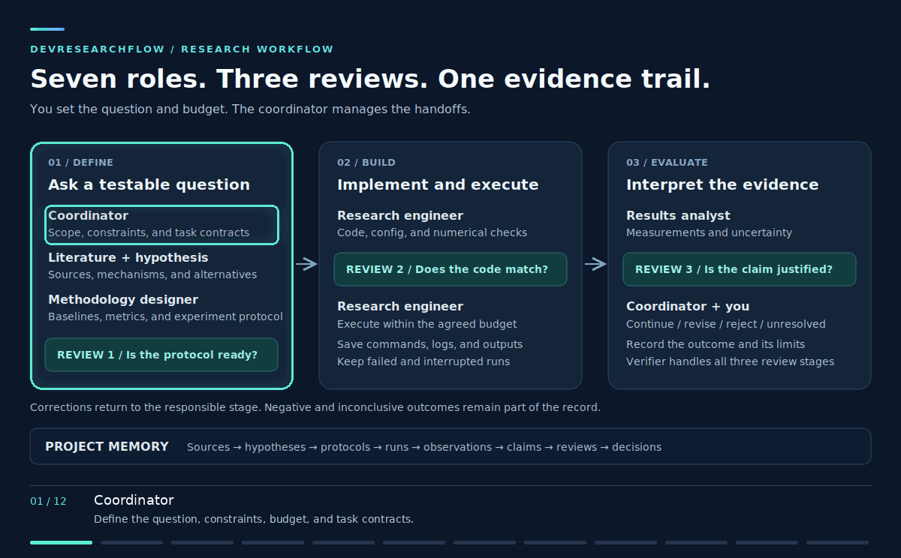

# DevResearchFlow

A research workflow for AI agents: reviewed protocols, captured execution evidence,
and conclusions linked to sources and measurements.



Seven role contracts coordinate research through protocol, implementation and
evidence reviews. Python tools check structure, provenance and review gates;
independent reviewers assess scientific substance.

## Quick start

Requires Python 3.10+, Git and an AI agent of your choice. The execution runner
and setup scripts target Unix-like systems; use WSL on Windows.

Install from this checkout (the 0.3 release is on `dev`):

```bash
git clone --branch dev https://github.com/Shakthi-Bala/DevResearchFlow.git
cd DevResearchFlow
uv tool install .
```

Alternatively use `pipx install .` or `python3 -m pip install .`. No package has
been published to PyPI. Graphify is optional and is not required by these commands.

```bash
mkdir ~/my-research
cd ~/my-research
git init
drf init . --ci
drf status
```

Initialization preserves existing files and installs a staged-record pre-commit
hook by default in Git projects. Use `--no-hooks` to opt out. Existing hooks and
CI files are preserved. New projects require execution receipts and reviewer
identities; existing projects keep their legacy policy during updates.

Load `.research-toolkit/agents/coordinator.md` in your agent and give it:

> Read research/WORKFLOW.md and research/brief.md. Help me bound the question,
> plan and budget. Assign specialist work and independent reviews. Use fresh
> reviewer sessions, preferably a different model. Preserve failures and uncertainty.

Follow [Your first experiment](docs/first-experiment.md) for the full path from
question to a reviewed result, including exact prompts and commands.

## Everyday commands

```bash
drf new hypothesis HYP-001 --model YOUR_MODEL --session YOUR_SESSION
drf review REV-001 --type protocol --model REVIEW_MODEL --session FRESH_SESSION \
  research/experiments/EXP-001.yaml
drf run RUN-001 --timeout 3600
drf check
drf check --staged
drf status
```

Create and review an experiment before preparing a run; `drf run` executes a
previously planned run. It refuses changed reviewed code, verifies per-file dataset
manifests, and captures logs, timestamps, exit codes, checksums and receipts.
A failed attempt remains evidence and needs a fresh run ID for another attempt.

Receipts detect ordinary edits and missing evidence. They are **not cryptographic
attestation** against someone controlling the repository, checker and execution host.
A passing validator does not establish scientific correctness.

## Learn and configure

| Guide | Purpose |
| --- | --- |
| [Runnable example](examples/toy-ablation/README.md) | Real execution, failed run, stale review, contradicted hypothesis; reviews are labeled teaching fixtures. |
| [First experiment](docs/first-experiment.md) | Ten steps with coordinator and verifier prompts. |
| [Daily commands](workflows/research/DAILY_USE.md) | Records, datasets, execution, status, hooks and CI. |
| [Record transitions](docs/record-states.md) | State diagram for every record type. |
| [Role permissions](docs/permissions.md) | Opt-in Codex and Claude runtime profiles and their limits. |
| [Migration and trust](docs/provenance.md) | Policy versions, identities, preregistration, receipts and branch protection. |
| [Architecture and roles](docs/guide.md) | Full design and engineering rationale. |
| [Optional Graphify](docs/graphify.md) | Code navigation, separate from research evidence. |
| [Changelog](CHANGELOG.md) | Versioned changes. |

A real thesis pilot and a separate simplified exploratory tier remain future work.
There is no automatic experiment scheduler or guaranteed independent AI reviewer.

## Development

```bash
python3 -m pip install -e '.[dev]'
python3 -m unittest discover -s workflows/research/tests -v
ruff check .
ruff format --check . bin/research-init
mypy
```

CI also reports subprocess coverage and builds/tests the wheel. See the
[validation summary](docs/release-review.md) for the limits of local checks.

[MIT license](LICENSE). Optional code navigation uses [Graphify](https://github.com/Graphify-Labs/graphify).
