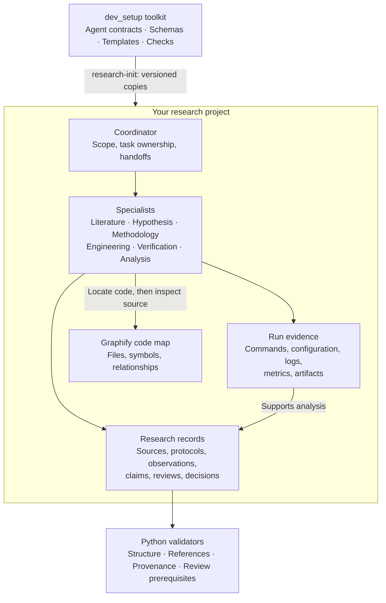

<div align="center">

# dev_setup

### A structured research workflow for any AI agent

Seven agent roles · Three independent review stages · Versioned research evidence

[Quick start](#quick-start) · [Architecture](#architecture) · [Engineering](#engineering-decisions) · [Usage](#everyday-use) · [Detailed guide](workflows/research/README.md)

</div>


`dev_setup` turns a research question into a sequence of defined tasks, reviewed
experiments, and evidence-linked conclusions. A coordinator manages specialist
agents; an independent verifier checks the experiment protocol, implementation,
and final interpretation.

The toolkit combines **reusable agent role contracts**, **Python validation tools**,
**JSON Schema record formats**, and an optional **Graphify code map**. Each research
project retains its own evidence and history. You remain responsible for the
research direction, budget, and final scientific interpretation.

## The problem it addresses

An agent's answer is easier to trust when you can inspect the source, the code,
the command that ran, and the limits of the result. Research also needs a record
of failures, alternative explanations, and evidence that contradicts a conclusion.

This project makes those records part of the workflow:

| Research need | Implemented approach |
| --- | --- |
| Clear responsibilities | Seven role contracts with assigned writing areas and handoff requirements. |
| Review before execution | Separate protocol and implementation reviews before substantial experiments. |
| Traceable conclusions | Claims link to observations, sources, reviews, and explicit scope. |
| Reproducible run records | Frozen protocols, code revisions, configuration hashes, commands, and raw artifacts. |
| Safe reuse across projects | An initializer that preserves customizations and records installed toolkit versions. |
| Detectable record errors | Schema, reference, checksum, review-prerequisite, and Git history checks. |

## Architecture

The reusable toolkit lives in `dev_setup`. Scientific records belong to the
project where the research happens.



**Research records store scientific knowledge; Graphify indexes the implementation.**
Agents connect them through file paths, qualified symbols, and Git revisions.
The generated code graph is a navigation aid; the underlying records and artifacts
remain the evidence to inspect.

## Quick start

Requires **Python 3.10+**, **Git**, and **an AI agent of your choice**. The workflow
currently lives on the **`dev` branch**. Role instructions and research records
are reusable across agents; map role loading, tool access, and delegation to your
chosen runtime.

### 1. Get the toolkit

```bash
git clone --branch dev https://github.com/Shakthi-Bala/dev_setup.git ~/dev_setup
```

Already cloned it? Use your existing checkout. Replace `~/dev_setup` below with
its actual location if different.

### 2. Prepare your project

For a new project:

```bash
mkdir -p ~/my_research_project
cd ~/my_research_project
git init
```

For an existing project, open its folder instead. Then install the workflow:

```bash
~/dev_setup/bin/research-init .
python3 -m venv .venv-research
.venv-research/bin/python -m pip install -r .research-toolkit/requirements.txt
```

Initialization creates the seven agent definitions, record templates, checking
tools, and initial research brief. Existing files and customized agents are
preserved. Experiments start only after you define the question and agree a plan.

### 3. Give your AI agent the coordinator role

Open your project in your preferred AI agent. Load the coordinator instructions
from `~/dev_setup/workflows/research/agents/coordinator.md`, using your agent's
instruction or context-loading mechanism. The other six role contracts are in
the same folder. Adapt runtime-specific frontmatter and tool names as needed;
the Markdown bodies define the research responsibilities.

Give the coordinator a bounded question and clear limits:

```text
Read research/WORKFLOW.md and research/brief.md. Use all seven agent roles.

Research question: [what you want to investigate]
Constraints: [dataset, hardware, deadline, and other limits]
Compute and token budget: [your limits]

Help me complete the brief and agree an initial plan before substantial experiments.
Manage specialist handoffs and the protocol, implementation, and evidence reviews.
Preserve failed runs, contradictory evidence, and uncertainty.
Commit completed changes. Do not push unless I ask.
```

With delegation support, the coordinator invokes specialists when needed. If your
agent cannot delegate, assign the roles across separate sessions and pass the
versioned task records between them. Keep verification in a separate reviewer
context from the work being evaluated.

The current initializer also writes integration files using a particular agent's
folder conventions. Other runtimes should load the reusable role contracts above
and register them through their own instruction system; automatic adapters for
every runtime are not included.

## The seven roles

| Role | Responsibility | Main output |
| --- | --- | --- |
| **Coordinator** | Scope the question, assign tasks, route corrections, and report progress. | Brief, task contracts, state, decisions. |
| **Literature researcher** | Read primary sources and separate author claims from reproduced findings. | Source notes with exact passages and limitations. |
| **Hypothesis researcher** | Propose mechanisms, competing explanations, and falsification conditions. | Testable hypotheses and alternatives. |
| **Methodology designer** | Define baselines, controls, metrics, repetitions, and resource limits. | Versioned experiment protocol. |
| **Research engineer** | Implement reviewed protocols, execute experiments, and preserve evidence. | Code, checks, run manifests, logs, artifacts. |
| **Independent verifier** | Challenge the protocol, implementation, and conclusions. | Three distinct review reports with findings and uncertainty. |
| **Results analyst** | Compute measurements and assess uncertainty, failures, and claim scope. | Reproducible analysis, observations, proposed interpretations. |

Corrections return through the coordinator. A negative or inconclusive outcome is
preserved with its evidence and limitations. Agent agreement alone does not count
as scientific support.

## Engineering decisions

| Decision | Why it matters |
| --- | --- |
| **Copy project instructions and record their origin** | A toolkit update does not silently change a project's governing instructions. |
| **One assigned writer per file** | Ownership and handoffs reduce competing edits to shared research records. |
| **Separate observations from claims** | Interpretations can change while the original measurements remain intact. |
| **Pin review targets and artifact checksums** | Changed evidence or protocols can be detected instead of silently reusing a stale review. |
| **Preserve terminal run records** | Optional Git-baseline checks detect modified or deleted execution manifests. |
| **Separate structural and scientific review** | Deterministic tools check records; the verifier assesses whether the evidence supports the conclusion. |

### Verification

The integration suite contains **26 tests** covering initialization, customization
preservation, stale reviews, broken references, corrupted artifacts, run history,
and installed validation commands.

With the validation dependencies available:

```bash
python3 -m unittest discover -s workflows/research/tests -v
```

[Inspect the test suite](workflows/research/tests/test_toolkit.py) ·
[Inspect the validation tools](workflows/research/checks/)

## Everyday use

Reopen the project in your preferred AI agent, load the coordinator role, and ask:

> Read the brief, current state, and recent decisions. Summarize progress, identify
> blockers, and continue within the agreed plan and budget.

Check its records:

```bash
.venv-research/bin/python .research-toolkit/checks/validate_records.py .
```

Also compare allowed status changes and run history against the latest commit:

```bash
.venv-research/bin/python .research-toolkit/checks/validate_records.py . --base-ref HEAD
```

### Where to find things

```text
my_research_project/
├── .research-toolkit/     Schemas, templates, and validation tools
├── research/
│   ├── brief.md           Question, constraints, budget
│   ├── state.yaml         Active work, blockers, next decision
│   ├── sources/           Primary-source notes
│   ├── hypotheses/        Explanations and planned tests
│   ├── experiments/       Protocols defined before execution
│   ├── observations/      Recorded measurements
│   ├── claims/            Scoped interpretations and evidence links
│   ├── reviews/           Independent review findings
│   └── decisions/         Outcomes and their rationale
├── runs/                  Actual execution evidence, including failures
├── src/                   Implementation
├── analysis/              Reproducible analysis scripts
└── graphify-out/          Optional generated code index
```

The reusable role contracts live in `workflows/research/agents/` in this toolkit.
The initializer also creates agent integration files, task, question, and session
folders, configurations, scripts, and a verification-test directory. See the [full project layout](workflows/research/README.md#installed-project-layout).

## Optional: Graphify code navigation

Graphify provides a code-navigation CLI that any agent with terminal access can
use. The machine installer installs `uv`, the pinned Graphify CLI, and command
shortcuts. It also writes tool-specific assistant integrations; inspect `install.sh`
if you want to manage those separately.

```bash
cd ~/dev_setup
./install.sh
export PATH="$HOME/.local/bin:$PATH"
```

Build and query the code map from your project with the CLI:

```bash
cd ~/my_research_project
graphify extract . --code-only
graphify cluster-only . --no-label
graphify query "how does data loading work"
graphify explain "SomeClass"
graphify update .
```

Code-only extraction runs locally. Ask your agent to use the CLI for navigation
and inspect the underlying source before making correctness claims. The
convenience setup scripts also offer assistant-specific integrations; those are
separate from the shared research process and Graphify CLI.

## Update an existing installation

```bash
cd ~/dev_setup
git switch dev
git pull --ff-only
./bin/research-init ~/my_research_project --update
```

Unchanged managed files are refreshed; local customizations and scientific
records are preserved. Review and commit project updates. Rerun `./install.sh`
when you also want to refresh the machine's Graphify setup.

## Current scope

This is a working toolkit of agent instructions and local utilities. The
coordinator follows the workflow in your chosen AI environment; there is no separate
always-running orchestration service or automatic experiment launcher.
Review prerequisites are checked when the validator runs, rather than enforced
by an execution scheduler. Passing validation establishes structural properties,
not scientific correctness. Reviewers and the principal investigator assess the
substance of the evidence.

For record formats, review dispositions, provenance rules, and reproducibility
details, read the [research operating guide](workflows/research/README.md).
