# Record transitions

Generated from validator transitions and schema enums. Regenerate with `python scripts/render_record_states.py`; CI checks for drift.

Commit gates as they occur. A valid runner receipt also permits a planned run to reach a terminal state in one Git commit because it records the actual start. Terminal manifests remain immutable.

## Question

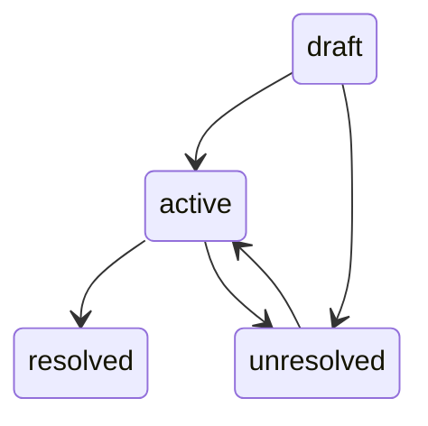

## Task

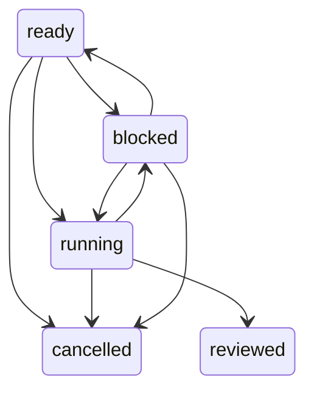

## Source

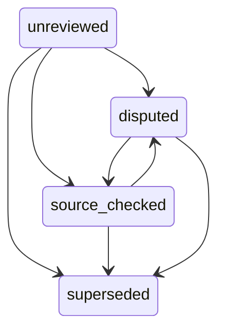

## Hypothesis

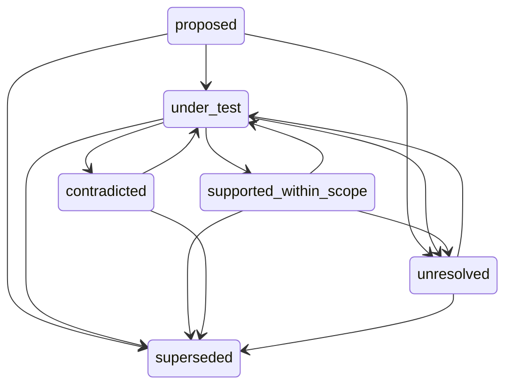

## Experiment

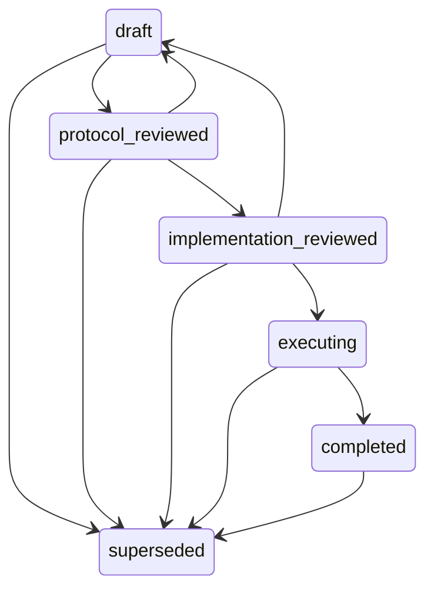

## Run

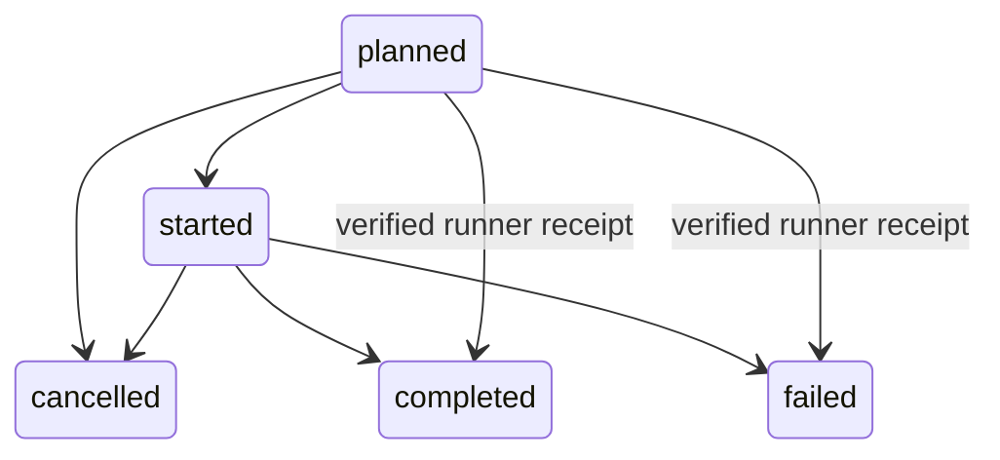

## Observation

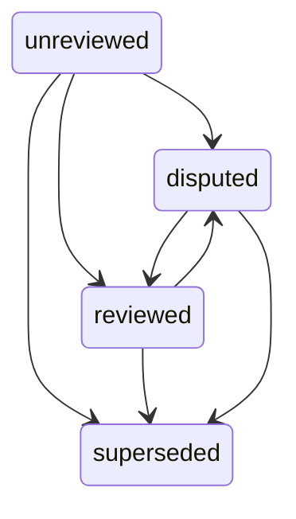

## Claim

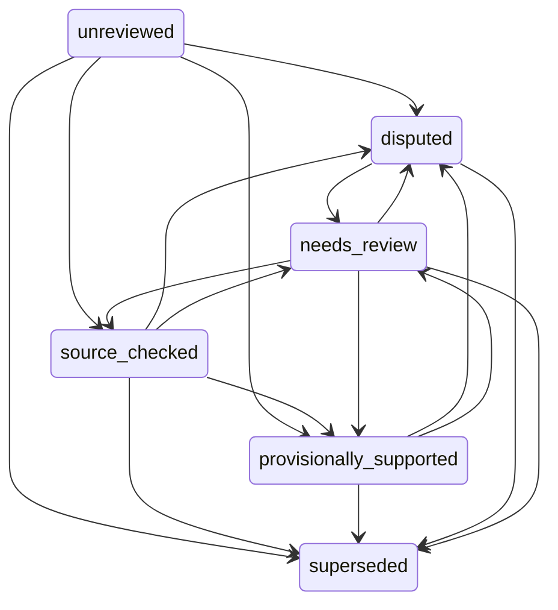

## Review

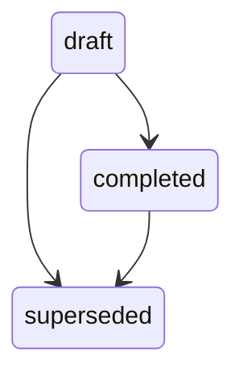

## Decision

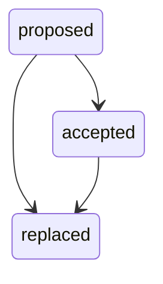

## Project state

`research/state.yaml` is a pointer/status document rather than a lifecycle record. Its `phase` is free text; these links are type-checked.

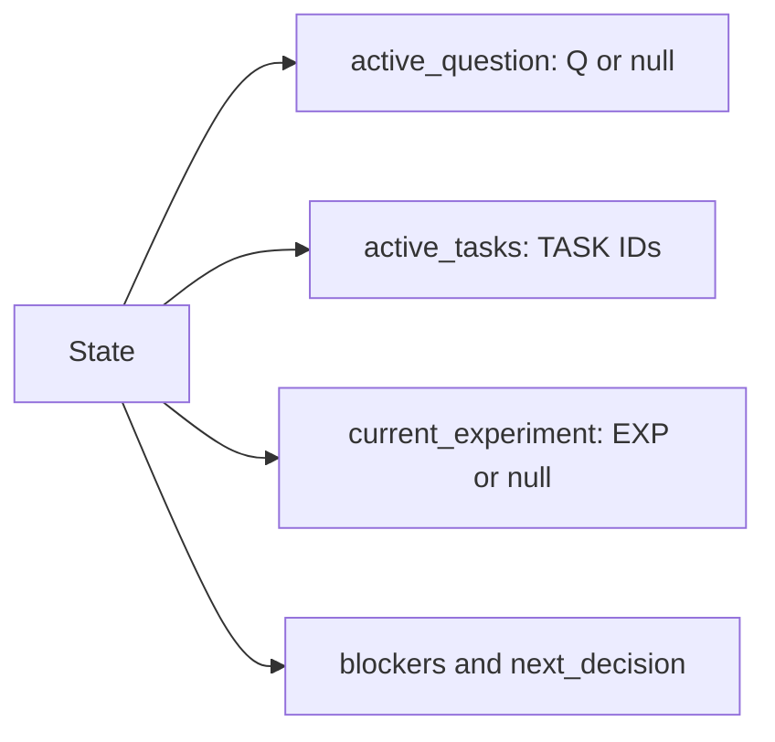
