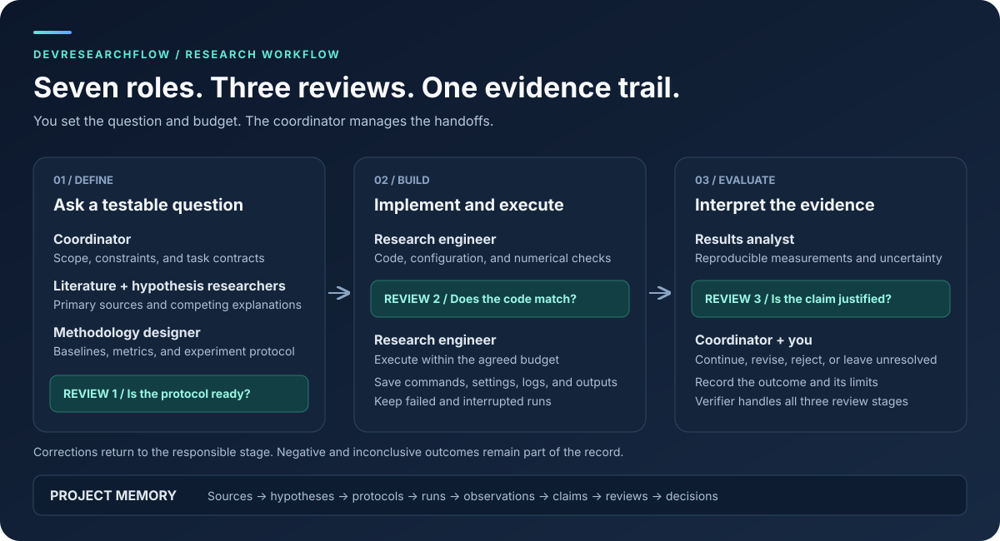

# Workflows

[Research](research/README.md): seven agent roles, coordinator-managed handoffs,
three independent verification stages, project-local evidence, and validation.
Install into a project with `research-init /path/to/project`.

