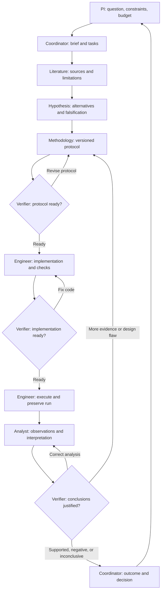

# Seven-role research workflow

Reusable instructions and evidence formats for research projects. The user is the
principal investigator (PI). All seven roles exist and run when needed; they do
not need seven continuously running sessions. The coordinator assigns tasks and
routes corrections. The verifier performs three distinct reviews.

This toolkit provides reusable agent role contracts and local validation utilities. It does
not automatically launch experiments, grant compute budgets, or establish the
scientific validity of a result. Agent instructions define writing ownership;
they are not filesystem access controls. A single coordinator owns Git operations
unless a task explicitly delegates them. Commit project updates; push only when
the user authorizes it.

## Install and start

From the toolkit checkout, run `./bin/research-init /path/to/project`. After `./install.sh`,
`research-init /path/to/project` is available through `~/.local/bin`.
Initialization requires Python 3.10+ and Git for revision recording. It performs
no network access or package installation. To also opt into the existing Graphify
installation, code indexing, and integrations, add `--graphify`.

In the project:

```bash
python3 -m venv .venv-research
.venv-research/bin/python -m pip install -r .research-toolkit/requirements.txt
.venv-research/bin/python .research-toolkit/checks/validate_records.py .
```

Example initial instruction:

> Read research/WORKFLOW.md and the brief. Use all seven roles. First help me
> bound the question and agree a plan and resource budget. Then assign versioned
> tasks and apply protocol, implementation, and evidence review gates. Preserve
> failures and uncertainty. Commit completed updates; do not push unless I ask.

Fill `research/brief.md` and `research/questions/Q-001.md`. Their initial draft
placeholders are not an agreed research plan.

Open the project in your preferred AI agent. Load the coordinator contract from
`.research-toolkit/agents/coordinator.md` in your project. Load the other
six contracts from the same folder when assigning specialist tasks. Map the
runtime-specific frontmatter, tool names, and delegation mechanism to your own
agent environment; the Markdown bodies define the reusable research contracts.

Use native delegation when supported. Otherwise assign roles to separate sessions
and pass self-contained task records between them. Keep the independent reviewer
in a separate context from the implementation or conclusion it evaluates. Models
and permission settings are controlled by your chosen environment.

The default installation copies the seven contracts to `.research-toolkit/agents/`
and appends a workflow block to `AGENTS.md` while preserving existing instructions.
Register these versioned copies through your agent's own instruction system.
Runtime-specific convenience integrations are opt-in; inspect `research-init --help`
for available options. Research records and Python checks are shared across environments.

## Shared agent rules

These rules apply to all seven role contracts. Load this section with the assigned
role; role files contain only their writing area, checklist and completion contract.

- Read the brief and task contract. Work within the PI's agreed scope and budget;
  record consequential direction changes. Task instructions assign ownership,
  not filesystem permissions.
- Modify only assigned paths within your role's area. One writer owns each file;
  route corrections through the coordinator rather than editing another writer's evidence.
- Research records and raw artifacts are authoritative. Session notes are unreviewed.
  Use optional Graphify only to locate code, inspect source at its recorded revision,
  and broaden the search when retrieval is empty. Never edit its generated graph as research memory.
- Never fabricate sources, execution outcomes, commands, review completion or evidence.
  Preserve failures, counterevidence, uncertainty and superseded history. Scope results
  to the relevant data, hardware, calibration, protocol and code versions.
- At handoff return task ID, input IDs/versions, output paths/IDs, evidence, actual
  checks/results, deviations, uncertainty/blockers and next dependency. Run structural
  checks on changed records without delaying preservation of failed/interrupted runs.
- Completion requires the assigned acceptance criteria and an evidence-linked handoff.
  Otherwise identify the unmet criterion and smallest next action. Structural validity
  and agent agreement do not establish scientific support.
- Only the coordinator or delegated single Git writer commits changes. Push only when
  the user authorizes it.

For verification, prefer a different model and always start a fresh reviewer context
that has not authored the implementation or conclusion. Give the reviewer the question,
protocol, code and raw evidence before author summaries. Ask it to independently
recompute critical numbers and report actual commands, disagreements and limits.
Model diversity reduces some shared blind spots; it does not guarantee independence
or correctness. Runtime/model selection remains the user's responsibility.

## Controlled loop



Literature discovery and initial brainstorming may overlap. Implementation
requires a sufficiently defined, reviewed protocol. Substantial execution requires
both protocol and implementation reviews and an agreed budget. An inconclusive
review is a valid scientific outcome; it cannot unlock an execution/support gate
that requires `supported_within_scope`. Lightweight exploration must be labeled
and bounded. A stronger confirmatory claim requires a protocol defined before a
subsequent evaluation. Do not retrospectively change success criteria.

## Roles and writing ownership

| Role | Primary writes | Required handoff |
| --- | --- | --- |
| Coordinator | Brief, state, questions, tasks, decisions; controlled claim status | Plan, assignments, evidence-linked outcomes, PI decisions |
| Literature | Sources, assigned unreviewed source-derived claims | Exact passages, document versions, author reports, limits, counterevidence |
| Hypothesis | Hypotheses | Mechanisms, assumptions, alternatives, falsification conditions |
| Methodology | Experiment specifications | Baselines, controls, splits, metrics, repetitions, budget, failure criteria |
| Engineer | Source, configs, scripts, implementation tests, runs | Code/patch, checks, actual commands, run evidence, deviations |
| Verifier | Reviews, tests/verification | Mathematical, implementation, and scientific findings with uncertainty |
| Analyst | Analysis scripts, observations, assigned unreviewed claim drafts | Reproducible measurements, all-run analysis, scoped interpretation |

Each task has one owner and each file one assigned writer at a time. Shared claim
files are assigned explicitly. A verifier requests changes through the coordinator
rather than repairing the implementation it reviews. Review the question,
protocol, code, and raw evidence before persuasive summaries where practical.
Different agents still share blind spots; agreement is not independent evidence.

A task contract records objective/ID, input IDs and versions, allowed writes,
limits, outputs, acceptance criteria, dependencies, uncertainty, and blockers.
The response adds output paths/IDs, evidence, actual checks/outcomes, deviations,
and the next dependency. Engineer-to-verifier handoffs must include the exact
protocol, commit and patch, commands actually run, run IDs and artifacts, check
results, and known deviations.

## Installed project layout

```text
.research-toolkit/       copied agents, schemas, templates, checks, requirements
AGENTS.md                shared workflow block; existing instructions retained
.gitignore               local validation environment and Python caches ignored
research/
  WORKFLOW.md            this operating procedure
  brief.md               question, intended contribution, constraints, PI direction
  toolkit_version.json   source revision and per-installed-file provenance
  state.yaml             active question/tasks, phase, blockers, next decision
  questions/             Q-001.md
  tasks/                 TASK-001.yaml
  sources/               SRC-001.md
  hypotheses/            HYP-001.yaml
  experiments/           EXP-001.yaml
  observations/          OBS-001.yaml
  claims/                CLM-001.yaml
  reviews/               REV-001.md
  decisions/             DEC-001.md
  sessions/              explicitly unreviewed working notes
src/ configs/ scripts/ analysis/ tests/verification/
runs/RUN-001/            manifest.yaml and actual execution evidence
```

Optional runtime-specific integrations are available through explicit flags;
inspect `bin/research-init --help`. Default role contracts are project-local in
`.research-toolkit/agents/`; their source is `workflows/research/agents/` in the
toolkit checkout. Existing integration files from earlier releases are preserved.

The initializer creates directories and the initial question, brief, and state.
It does not fabricate source notes, hypotheses, experiments, reviews, or runs.
Copy templates from `.research-toolkit/templates/` when the corresponding work
starts. Change the ID/filename, scope, and every `SET_ME` value. Zero hashes in
run/observation templates are placeholders and must be replaced with real hashes.
`references` holds additional record links; typed fields carry specific links.
Record filenames must match IDs; run IDs match their enclosing directory.
Markdown records require YAML frontmatter; YAML and JSON records are also read.

## Evidence, runs, and reviews

Observations preserve measurements; claims interpret them. Keep assumptions,
limitations, supporting and contradicting evidence, explicit scope, and the check
method. Source inspection, numerical checks, implementation review, and independent
reproduction establish different properties. Failed, cancelled, and inconclusive
attempts remain discoverable. Supersede rather than erase corrected conclusions.

Planned runs and runs cancelled before starting do not require execution artifacts.
Record the cancellation time and reason. Each actual execution gets a new run
directory and manifest. Persist evidence
immediately, even if validation fails. Never withhold a failed/interrupted run
until a review or schema check passes. Capture:

- Exact code revision and any patch, actual command, seed, hardware, dataset
  version and manifest checksum, environment, resolved configuration, deviations.
- `protocol.yaml`: a frozen copy of the experiment record, plus its file checksum
  in `protocol_snapshot` and the stable protocol-content hash in `protocol_sha256`.
- `stdout.log`, `stderr.log`, timestamps, exit code, status, and reason for failure
  or cancellation. Preserve partial logs and outputs after interruption.
- Metrics and artifact paths with SHA-256 checksums. Optional `artifacts.json` can
  catalogue large external outputs with stable URLs and checksums; list the local
  catalogue itself as a checksummed artifact. Validators check local catalogues,
  not availability or content of remote objects.

Resolved configurations must match the implementation-reviewed configuration.
If parameters change, obtain the appropriate review before another run. A patch
must be preserved as a local checksummed file, pinned in the implementation review
and matched by the run manifest, but this first version cannot
prove which code produced a run. Reviews must inspect commit/patch and execution
evidence; structural validation does not prove honest execution or correctness.
Never edit terminal run records; append a correction record or create a new run.

Reviews pin their targets using `target_versions`. Generate the stable hash with:

```bash
.venv-research/bin/python .research-toolkit/checks/record_hash.py \
  research/experiments/EXP-001.yaml --review-type protocol
sha256sum runs/RUN-001/protocol.yaml
```

Use `--review-type implementation`, `evidence`, or `source` for the other reviews.
The content hash excludes mutable status/review/run links to avoid circular
references. Protocol hashes also exclude the not-yet-pinned implementation commit
and configuration hash (plus implementation patch and author identity); implementation
hashes include these pinning fields. All other protocol
content changes invalidate the relevant review. Record each review's checks,
limitations, findings/severity, required correction, and disposition. Completed
supporting reviews cannot have unresolved blocking findings. A stale review must
be superseded and replaced; retain it for historical runs. Historical run gates
use the frozen protocol and retained review instead of the current experiment.

## Deterministic validation

```bash
.venv-research/bin/python .research-toolkit/checks/validate_records.py .
.venv-research/bin/python .research-toolkit/checks/check_references.py .
# Also compare statuses, protocol versions, and terminal-run immutability:
.venv-research/bin/python .research-toolkit/checks/validate_records.py . --base-ref HEAD
```

Checks cover schemas/allowed statuses, duplicate IDs/keys, typed references,
local artifact existence/checksums, current review prerequisites, run provenance,
and state references. `--base-ref` checks allowed transitions against that commit;
record intermediate gates in Git before later transitions. Without a baseline,
historical transition validation is not claimed. Validation can run manually or through the optional staged-tree hook and project CI;
see [automation and helpers](DAILY_USE.md). These checks do not enforce
experiment execution or grant scientific approval.

Claims list checksummed local `dependencies` (code, config, data manifests,
calibration, or protocols). A changed dependency fails validation until the claim
is marked `needs_review` or superseded. That status permits retaining old hashes
and evidence. Obtain a fresh review and update dependency hashes before promotion.
Changes in unlisted dependencies cannot be detected. These checks do not assess
source fidelity, baseline fairness, statistical validity, budget compliance, or
scientific truth; those remain verifier and PI responsibilities.

## Memory and Graphify

Canonical research files and raw evidence belong to each project. Graphify remains
the generated code-navigation layer (`graphify-out/`); agents must not use its
JSON as the only persistent research memory. Follow records through stable IDs:
question → hypothesis → experiment → run → observation → claim → review → decision.
Link implementation by project, relative file path, qualified symbol, and commit.
Do not rely on Graphify-generated node IDs as scientific entity identifiers.

Retrieve relevant constraints, recent decisions, claims and counterevidence rather
than loading all memory. Graphify locates code; inspect the underlying source at
the recorded revision. Research records locate scientific evidence; inspect the
primary document or raw artifact. Empty graph results require a broader search.
For code changes, refresh the code index using the existing Graphify integration.
This toolkit does not implement a Graphify research-entity adapter or merge
scientific records into the code graph.

## Toolkit verification

From the toolkit checkout, run `python3 -m unittest discover -s workflows/research/tests -v`
with the validation dependencies installed. Tests exercise safe initialization,
customization preservation, stale evidence, review gates, run history, and the
installed check commands. They do not launch model sessions or experiments.

## Updating and reproducibility

Definitions are copied rather than symlinked, so toolkit updates do not silently
change a project's governing instructions. `research-init PROJECT --update`
refreshes only previously managed, unchanged files and installs missing files.
Customized files, scientific records, and existing project instructions are preserved.
Review customized agents manually against the new definitions. The metadata tracks
each file's installed hash and originating revision, plus dirty-source state;
mixed revisions remain visible. Existing projects are never silently committed.
Run the validator and commit accepted project changes yourself or through the
coordinator. Keep raw artifacts in appropriate storage with stable references and
checksums; choose project-specific ignore rules rather than ignoring all runs.

After updating a project, reinstall `.research-toolkit/requirements.txt` into its
validation environment so optional format checks remain available.

## Examples and daily use

The toolkit checkout contains a runnable toy ablation at `examples/toy-ablation/`.
Use the [record helpers and optional validation automation](DAILY_USE.md)
to reduce bookkeeping while retaining review requirements.

## Captured execution and strict policy

Use `drf` for daily commands; see [DAILY_USE.md](DAILY_USE.md). New projects require
runner receipts and actual author/reviewer identities; legacy policy is preserved
when updating existing projects. `drf run RUN-NNN` captures command output, timing,
exit status and declared artifacts after checking reviewed code and per-file data.
For implementation review, record the engineer in `implementation.author` as well
as the experiment's protocol author. The same reviewer/author session is rejected.
Confirmatory protocols must be committed before execution; supported strict claims
require registered confirmatory run evidence. Local receipts are integrity records,
not signed attestation against an actor controlling the host and repository.
